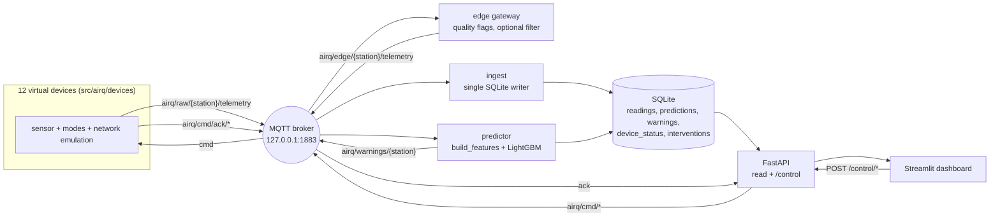
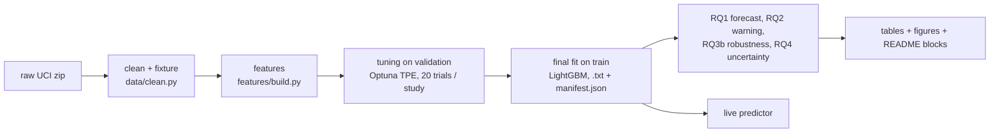
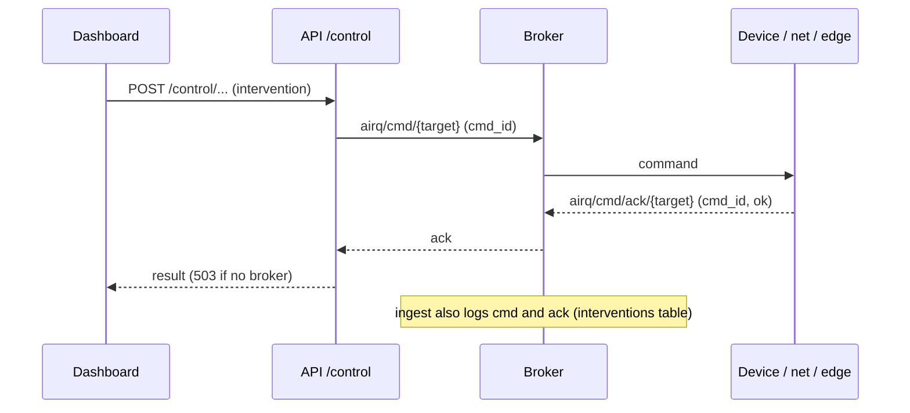

# Architecture

How the pieces of `airq-iot` fit together, and why. The README gives the overview and the results;
[docs/KARARLAR.md](docs/KARARLAR.md) (Turkish) logs every design decision with its evidence.

## 1. The idea in one paragraph

Real hourly measurements from 12 Beijing stations are *replayed* by 12 virtual IoT devices over MQTT
(trace-driven emulation, not simulated data). A data-quality **edge gateway** validates every message,
a single **ingest** process writes to SQLite, a **predictor** forecasts PM2.5 1 / 6 / 24 h ahead with
LightGBM and raises early warnings, a **FastAPI** service exposes the data and a **control** API, and a
**Streamlit** dashboard shows the network and lets you change the world while it runs (sensor values,
faults, network quality, the edge filter) through an MQTT command channel. A scoreboard measures how
forecasts and warnings react to each intervention.

## 2. Runtime data flow



Everything between the boxes is MQTT except the last hop (dashboard to API is plain HTTP, API to
database is SQLite). Nothing talks to the broker from the browser.

### Message contract

All topic names, QoS and retain flags live in one place, [`src/airq/iot/topics.py`](src/airq/iot/topics.py).

| Topic | QoS | Retained | Producer -> consumers |
|---|---|---|---|
| `airq/raw/{station}/telemetry` | 1 | no | device -> edge |
| `airq/edge/{station}/telemetry` | 1 | no | edge -> ingest, predictor |
| `airq/{station}/status` | 1 | **yes** | device (online / offline, last will) -> ingest, predictor |
| `airq/{station}/heartbeat` | 0 | no | device -> (liveness signal; nothing in the current system stores it) |
| `airq/warnings/{station}` | 1 | no | predictor -> any subscriber (the warning is also stored in the `warnings` table) |
| `airq/edge/stats` | 0 | no | edge -> ingest |
| `airq/cmd/{station}`, `fleet`, `net`, `edge` | 1 | no | API (controller) -> devices, network emulator, edge; ingest logs them as interventions |
| `airq/cmd/ack/{station}` | 1 | no | whoever executed the command -> controller, ingest |

Telemetry carries a per-device sequence number (`seq`), so the edge can flag gaps, duplicates and
reordering that the network emulator (loss, delay, jitter, reordering) introduces.

## 3. Components

| Component | Module | Responsibility |
|---|---|---|
| Virtual device | `devices/virtual_sensor.py`, `fleet.py` | One MQTT client per station: replays its row, heartbeat, retained status with last will, applies *modes* |
| Modes | `devices/modes.py` | manual, offset, scale, ramp, spike / stuck / dropout, offline: the knobs behind the control panel |
| Network emulation | `devices/netem.py` | Application-layer loss, delay, jitter and reordering per station (no OS-level `tc netem`) |
| Edge gateway | `edge/gateway.py`, `edge/quality.py` | Range, rate-jump, stuck, PM2.5 <= PM10, missing, `seq` checks; with the filter **on** an untrustworthy value is replaced by null |
| Ingest | `server/ingest.py`, `server/db.py` | The only database writer: edge telemetry, device status, edge statistics, and the command / ack log (`interventions`); idempotent upserts keyed by `(station, ts)` |
| Predictor | `server/predictor.py` | Waits for the hour to be complete (bounded wait), builds features, predicts h = 1, 6, 24, applies the validation-chosen warning margin, optional q10-q90 band |
| Controller | `server/control.py`, `control_api.py` | Publishes `cmd`, collects `ack`, exposes it as `/control/*` |
| Scorecard | `server/scorecard.py`, `server/truth.py` | Compares forecasts and warnings with the truth *replayed from the command log* |
| API | `server/api.py` | Read endpoints (stations, readings, forecast, warnings, tables, figures, stats) and the control endpoints |
| Dashboard | `dashboard/` | Six pages; reads the API only; HTML-escapes everything that came through MQTT |
| Scenarios | `scenarios/`, `configs/scenarios/` | Seven scripted runs (YAML) driven through the same command channel |

### Database

SQLite in WAL mode, one writer. Tables: `readings` (raw + edge-validated values, flags, `seq`,
sent / received time), `predictions` (`station, made_at_ts, horizon`), `warnings`
(`station, made_at_ts, horizon, threshold`), `device_status`, `interventions`, `system_events`.
`received_at - sent_at` is the end-to-end latency the RQ3a benchmark reports.

## 4. One definition, two places (offline = online)

Two pieces of logic exist in both the experiments and the live system, and each has **one** source:

| Logic | Source of truth | Used by | Guard |
|---|---|---|---|
| Features | `features/build.py` (`build_features`) | offline training / evaluation **and** the live predictor | `tests/integration/test_online_offline_parity.py`: live features and predictions equal offline ones (runs against a broker) |
| Edge quality rules | `edge/quality.py` (`flag_series` vectorised, `StreamChecker` incremental) | RQ3b robustness experiments **and** the live gateway | `test_vectorized_equals_streaming_on_random_data_with_faults` |

This is what makes the live demo meaningful: the model that is scored in the paper is the model that
runs in the system, fed by the same feature code.

## 5. The ML pipeline



- **Split is fixed** (`configs/default.yaml`): train 2013-03 to 2015-08, validation 2015-09 to
  2016-02, test 2016-03 to 2017-02. Preprocessing is fitted on train only, every choice is made on
  validation only, and features use values at or before `t` (PM10 is never used at `t+h`).
- **The test split is evaluated once** per protocol; guard files stop accidental re-runs, and a forced
  re-run is only for reproducibility fixes and is logged.
- **Stages are cached and idempotent.** `python -m scripts.run_all` rebuilds everything from the raw
  data (`--quick` uses a small fixture); each stage also has its own script under `scripts/`.
- **Research questions:** RQ1 forecasting (persistence, seasonal naive, ridge, LightGBM with and without
  neighbour features, ablation, LOSO, SHAP, Diebold-Mariano), RQ2 early warning (margin chosen on
  validation by F2, episode-level evaluation), RQ3a system benchmark (loss, delay, offline devices,
  CPU / memory), RQ3b robustness to faulty inputs and the edge filter, RQ4 calibrated q10-q90 intervals
  and a q90-based warning.
- **Numbers in the README and paper** come from `reports/` (`scripts/make_tables.py --readme`), never
  typed by hand.

## 6. Control channel and scoring



The scorecard does not trust what a device *says*: it **replays the command log** over the recorded
data (`server/truth.py`) to know what the true value would have been, then scores forecast error,
whether an exceedance was warned, and lead time per intervention. Paired edge off / on runs use the
same fault window twice.

## 7. Failure handling worth knowing

- **Missing station in an hour.** The predictor waits at most `iot.predictor_wait_ms` for each
  station, then predicts with fewer neighbours: the missing values stay missing (LightGBM handles them natively)
  and `n_neighbors_available` is itself a feature, so the stored `n_neighbors` shows the network damage.
- **Offline device.** The retained `status = offline` message (set by the last will) tells the
  predictor to stop waiting for that station after a grace period. The grace period exists because the
  status message can overtake telemetry still travelling through the edge hop. A *lost* message is
  indistinguishable from a late one, so that wait remains (documented RQ3a limit at 3600x).
- **Duplicates and reordering.** QoS 1 redelivery and the network emulator can duplicate or reorder
  messages; ingest upserts by `(station, ts)` and counts duplicates instead of failing.
- **No broker.** The dashboard still runs on a recorded database (`demo --offline`); control returns 503.

## 8. Security model

Research / teaching software: no authentication on the MQTT broker or the control API, **localhost
only**. Protections that are in place (loopback binds, Host / Origin checks, HTML escaping, path
validation, checksum-verified downloads, secret scanning) are listed in [SECURITY.md](SECURITY.md) and
tested in `tests/unit/test_security.py`.

## 9. Repository map

```
src/airq/            library code (nothing here depends on a notebook)
  data/ features/ models/ warning/ perturb/ eval/   leakage-safe ML core
  iot/ devices/ edge/ server/ scenarios/            the live system
  dashboard/                                         Streamlit UI (talks to the API only)
  pipelines/                                         stage orchestration (run_all, rq1..rq4, demo, release)
scripts/             thin command-line entry points  (python -m scripts.<name>)
configs/             default.yaml, mosquitto.conf, release.yaml, scenarios/*.yaml
notebooks/           thin notebooks that call the pipelines (generated by scripts/build_notebooks.py)
reports/  paper/     generated metrics, tables, figures (committed; small)
tests/               unit, integration (some need a broker), security
docs/                KARARLAR.md (decision log), NEDEN.md (why each component), assets
```

## 10. Extending it

| To add | Touch |
|---|---|
| A new device fault mode | `devices/modes.py` (+ spec validation in `scenarios/spec.py`) and a test |
| A new data-quality rule | `edge/quality.py` **only**; the parity test then covers offline and live |
| A new feature | `features/build.py` **only**; re-run the stages (`run_all`) so the numbers move together |
| A new scenario | a YAML file in `configs/scenarios/`; it is loaded by the player and listed in the dashboard |
| A new API endpoint | `server/api.py` with a response model; keep it read-only unless it goes through the controller |
