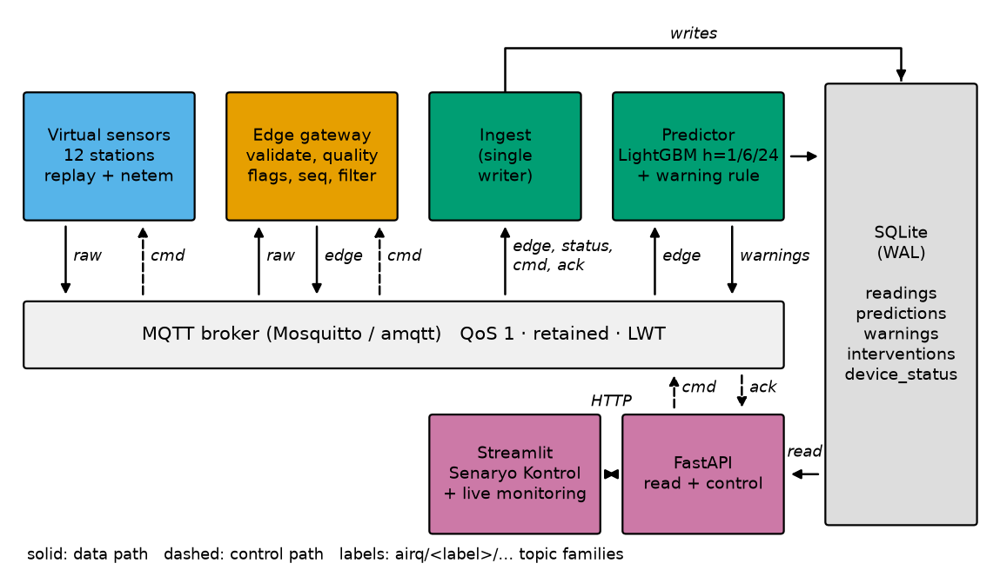
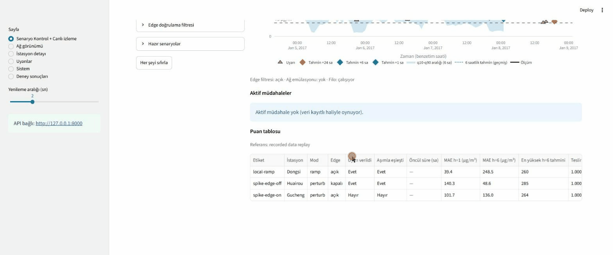
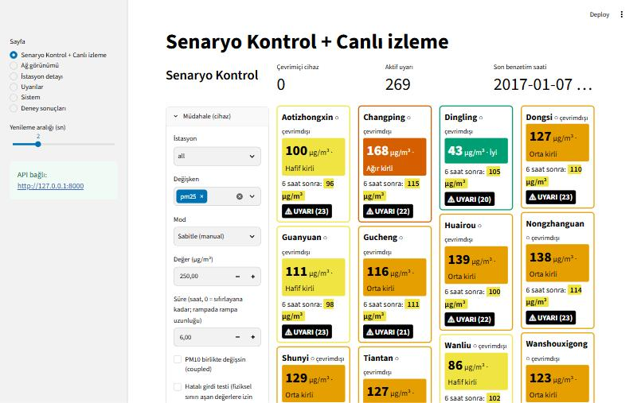
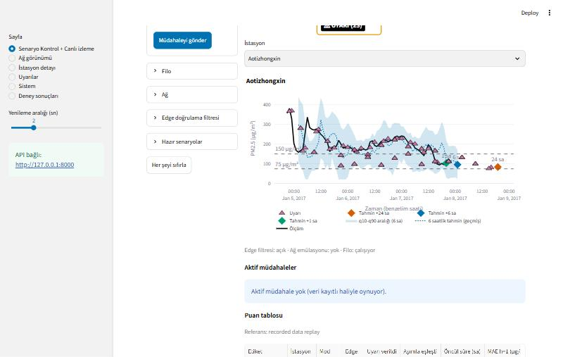
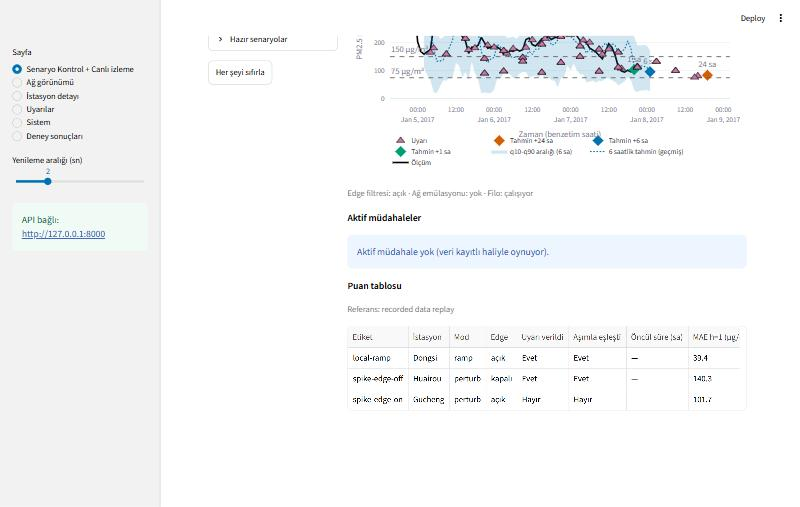
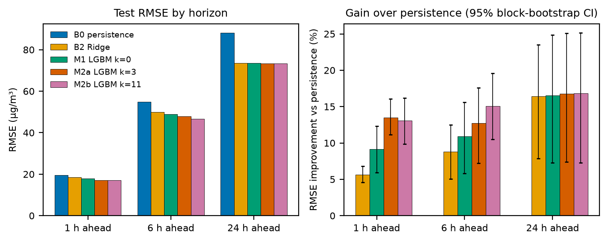
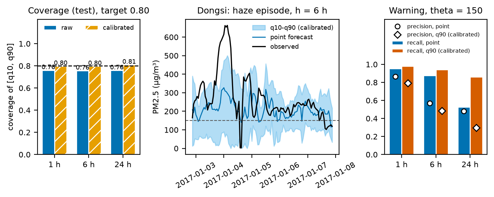
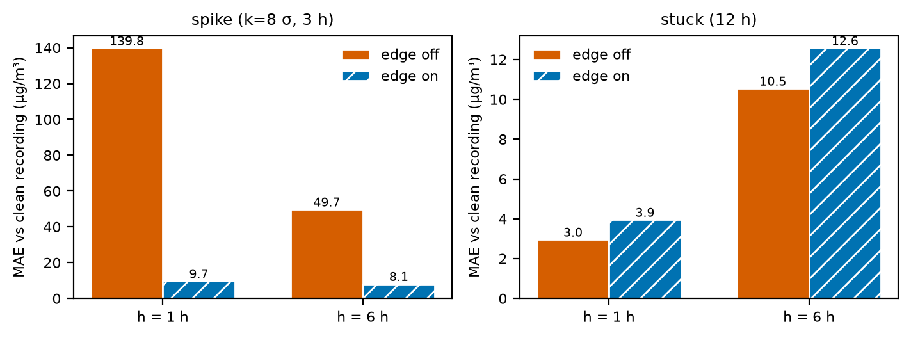
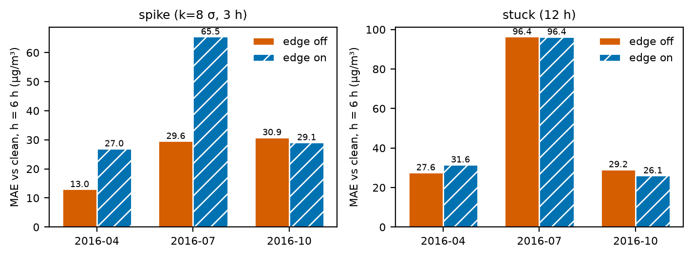

# airq-iot

[](https://github.com/furkantopcuu/airq-iot/actions/workflows/ci.yml)

IoT-based air quality monitoring with multi-horizon PM2.5 forecasting and early warning.
Real measurements from the Beijing Multi-Site Air-Quality dataset are replayed through 12 virtual
IoT devices over MQTT (trace-driven emulation), validated at an edge gateway, stored in SQLite,
forecast 1 / 6 / 24 h ahead with LightGBM, and shown on a live dashboard. A command channel
(MQTT `cmd` / `ack`) lets you change sensor values, inject sensor faults, degrade the network and
switch the edge filter **while the system runs**, and a scoreboard measures how the forecasts and
warnings react. Türkçe: [README.tr.md](README.tr.md).

Further reading: [ARCHITECTURE.md](ARCHITECTURE.md) (how the pieces fit together),
[FINDINGS.md](FINDINGS.md) (what the experiments found, including what did not work),
[SECURITY.md](SECURITY.md), [CHANGELOG.md](CHANGELOG.md).



## What is in the box

| Layer | What | Where |
|---|---|---|
| Devices | 12 virtual sensors (one MQTT client each, LWT, heartbeat, `seq`), network emulation (loss, delay, jitter, reordering) | `src/airq/devices/` |
| Edge | validation, data-quality flags (range, rate jump, stuck, PM2.5 <= PM10, missing, `seq` gaps), optional filter | `src/airq/edge/` |
| Server | ingest (single SQLite writer), predictor (same `build_features` as offline), FastAPI read + control endpoints | `src/airq/server/` |
| Control | `cmd` / `ack` channel, device modes (manual, offset, scale, ramp, spike / stuck / dropout, offline), fleet and edge control, 7 ready-made scenarios | `src/airq/scenarios/`, `configs/scenarios/` |
| ML | leakage-safe features, persistence / seasonal-naive / ridge / LightGBM, Optuna, LOSO, SHAP, DM tests | `src/airq/features/`, `src/airq/models/`, `src/airq/pipelines/` |
| UI | Streamlit dashboard (6 pages, scenario control panel) | `src/airq/dashboard/` |

## Live dashboard

Screenshots of the *Senaryo Kontrol + Canlı izleme* page from a recorded run (a real haze episode with a
local pollution ramp and sensor-spike faults, edge filter off and on). Replay it yourself without any
data or models: `python -m scripts.fetch_release --only demo`, then `python -m scripts.demo --offline`.

A short tour of the dashboard on that recording (live page and scoreboard, station detail with the
q10-q90 band, warnings):









## Results

Everything below is generated from `reports/tables/*.csv` by `python -m scripts.make_tables --readme`.
Every finding, including the negative ones and the caveats, is logged in
[docs/KARARLAR.md](docs/KARARLAR.md); the reasoning behind each technology choice is in
[docs/NEDEN.md](docs/NEDEN.md).

**RQ1 - forecast error on the held-out test year (RMSE, µg/m³; improvement over persistence in %)**

<!-- TABLE:rq1_main -->
| Model | RMSE h=1 | RMSE h=6 | RMSE h=24 | Δ% vs B0 h=1 | Δ% vs B0 h=6 | Δ% vs B0 h=24 |
|---|---|---|---|---|---|---|
| B0 persistence | 19.65 | 54.88 | 88.12 | 0.0 | 0.0 | 0.0 |
| B1 seasonal naive | 88.14 | 88.16 | 88.12 | -348.6 | -60.6 | 0.0 |
| B2 ridge (k=0) | 18.54 | 50.05 | 73.66 | 5.6 | 8.8 | 16.4 |
| M1 LightGBM (k=0) | 17.85 | 48.88 | 73.53 | 9.1 | 10.9 | 16.6 |
| M2a LightGBM (k=3) | 16.99 | 47.89 | 73.35 | 13.5 | 12.7 | 16.8 |
| M2b LightGBM (k=11) | 17.08 | 46.60 | 73.29 | 13.1 | 15.1 | 16.8 |
<!-- /TABLE:rq1_main -->



**RQ3b - faulty sensor inputs: RMSE increase with the edge filter off vs on (rows whose last 24 h contain a fault)**

<!-- TABLE:rq3b -->
| Method | h | RMSE clean | Damage, edge off | Damage, edge on | Recovered (%) |
|---|---|---|---|---|---|
| B0 persistence | 1 h | 20.42 | 45.74 | 7.27 | 84.1 |
| B0 persistence | 6 h | 56.97 | 24.70 | 1.75 | 92.9 |
| B0 persistence | 24 h | 90.19 | 13.94 | 0.52 | 96.2 |
| M1 LightGBM (k=0) | 1 h | 19.04 | 27.00 | 18.96 | 29.8 |
| M1 LightGBM (k=0) | 6 h | 51.03 | 8.83 | 8.12 | 8.1 |
| M1 LightGBM (k=0) | 24 h | 76.01 | 1.77 | 1.58 | 10.8 |
| M2b LightGBM (k=11) | 1 h | 18.09 | 22.36 | 14.65 | 34.5 |
| M2b LightGBM (k=11) | 6 h | 48.40 | 2.34 | 1.54 | 34.1 |
| M2b LightGBM (k=11) | 24 h | 75.96 | 0.57 | 0.56 | 2.2 |
<!-- /TABLE:rq3b -->

**RQ4 - forecast uncertainty: coverage of the [q10, q90] interval (target 0.80) and its pinball loss; calibration factor fitted on validation only**

<!-- TABLE:rq4_coverage -->
| h | Interval | c | Coverage | Coverage, extreme | Mean width | Pinball q10 | Pinball q50 | Pinball q90 |
|---|---|---|---|---|---|---|---|---|
| 1 h | raw | 1.00 | 0.761 | 0.741 | 24.6 | 2.12 | 4.35 | 2.30 |
| 1 h | calibrated | 1.10 | 0.798 | 0.774 | 27.0 | 2.12 | 4.35 | 2.29 |
| 6 h | raw | 1.00 | 0.756 | 0.578 | 77.3 | 5.90 | 13.13 | 6.97 |
| 6 h | calibrated | 1.10 | 0.797 | 0.621 | 85.0 | 5.88 | 13.13 | 6.93 |
| 24 h | raw | 1.00 | 0.758 | 0.279 | 136.7 | 7.14 | 24.76 | 13.06 |
| 24 h | calibrated | 1.05 | 0.809 | 0.321 | 143.6 | 7.18 | 24.76 | 12.94 |
<!-- /TABLE:rq4_coverage -->

**RQ4 - q90-based warning versus the point-forecast warning (theta = 150)**

<!-- TABLE:rq4_warning -->
| h | Method | δ | Precision | Recall | F2 | False alarm | Horizon-matched recall | Matched lead (h) |
|---|---|---|---|---|---|---|---|---|
| 1 h | B0 persistence | 15 | 0.817 | 0.963 | 0.930 | 0.094 | 0.72 | 0.0 |
| 1 h | M2b LightGBM (k=11) | 10 | 0.865 | 0.955 | 0.936 | 0.070 | 0.66 | 1.0 |
| 1 h | M3 q90 (calibrated) | 0 | 0.794 | 0.982 | 0.937 | 0.112 | 0.55 | 1.0 |
| 1 h | M3 q90 (raw) | 0 | 0.807 | 0.979 | 0.939 | 0.108 | 0.58 | 1.0 |
| 6 h | B0 persistence | 40 | 0.530 | 0.856 | 0.762 | 0.218 | 0.83 | 3.0 |
| 6 h | M2b LightGBM (k=11) | 40 | 0.568 | 0.876 | 0.790 | 0.181 | 0.80 | 3.0 |
| 6 h | M3 q90 (calibrated) | 0 | 0.484 | 0.940 | 0.791 | 0.261 | 0.87 | 4.0 |
| 6 h | M3 q90 (raw) | 0 | 0.513 | 0.929 | 0.799 | 0.233 | 0.86 | 4.0 |
| 24 h | B0 persistence | 40 | 0.378 | 0.613 | 0.545 | 0.218 | 0.63 | 20.0 |
| 24 h | M2b LightGBM (k=11) | 40 | 0.482 | 0.528 | 0.518 | 0.173 | 0.52 | 21.0 |
| 24 h | M3 q90 (calibrated) | 0 | 0.296 | 0.862 | 0.623 | 0.404 | 0.79 | 21.0 |
| 24 h | M3 q90 (raw) | 0 | 0.309 | 0.853 | 0.631 | 0.381 | 0.79 | 21.0 |
<!-- /TABLE:rq4_warning -->



**Senaryo Kontrol - hypotheses written down before running, and what the live system did** (one run per scenario)

<!-- TABLE:scenarios -->
| Scenario | Item | Metric | Expected | Reference | Measured | Verdict |
|---|---|---|---|---|---|---|
| ag_bozulmasi | net-degraded | delivery_ratio | less than | 0.95 | 0.88 | confirmed |
| ag_bozulmasi | net-degraded | latency_p95_ms | greater than | 250.00 | 318.00 | confirmed |
| bolgesel_artis | regional-ramp | warned | true |  | True | confirmed |
| cihaz_kopmasi | three-offline | min_n_neighbors | less than | 11.00 | 8.00 | confirmed |
| gercek_haze_replay | haze-replay | warned | true |  | True | confirmed |
| gercek_haze_replay | haze-replay | lead_time_h | greater than | 0.00 | 22.00 | confirmed |
| sensor_sicramasi | spike-edge-off | peak_forecast_h6 | greater than | 54.00 | 87.69 | confirmed |
| sensor_sicramasi | spike-edge-off | warned | true |  | True | confirmed |
| sensor_takilmasi | stuck-edge-off | mae_next_6h_h6 | greater than | 12.57 | 10.54 | refuted |
| yerel_artis | local-ramp | warned | true |  | True | confirmed |
| yerel_artis | neighbor-huairou | peak_forecast_h6 | less than | 101.91 | 39.03 | confirmed |
<!-- /TABLE:scenarios -->



**Paired runs: the same fault window with the edge filter off and on (3 start dates)**

<!-- TABLE:scenarios_ab -->
| Fault | Start | MAE h=1 off | MAE h=1 on | Δ h=1 | MAE h=6 off | MAE h=6 on | Δ h=6 |
|---|---|---|---|---|---|---|---|
| spike, 3 h | 2016-04-15 | 127.3 | 24.5 | 102.8 | 13.0 | 27.0 | -14.0 |
| spike, 3 h | 2016-07-20 | 79.7 | 36.8 | 42.9 | 29.6 | 65.5 | -35.9 |
| spike, 3 h | 2016-10-05 | 76.1 | 86.1 | -10.0 | 30.9 | 29.1 | 1.7 |
| spike, 3 h | mean of 3 | 94.4 | 49.1 | 45.2 | 24.5 | 40.6 | -16.1 |
| stuck, 12 h | 2016-04-15 | 29.3 | 32.6 | -3.2 | 27.6 | 31.6 | -4.0 |
| stuck, 12 h | 2016-07-20 | 46.3 | 51.4 | -5.2 | 96.4 | 96.4 | 0.1 |
| stuck, 12 h | 2016-10-05 | 43.5 | 49.4 | -5.8 | 29.2 | 26.1 | 3.1 |
| stuck, 12 h | mean of 3 | 39.7 | 44.4 | -4.7 | 51.1 | 51.4 | -0.3 |
<!-- /TABLE:scenarios_ab -->



The live-system benchmark (RQ3a: loss, delay, offline devices, CPU and memory) is in
`reports/tables/rq3a_bench.csv` and `reports/figures/rq3a_system.png`.

## Quick start (Linux, macOS, WSL, Git Bash)

```bash
bash scripts/quickstart.sh          # set up, fetch the recorded run, open the dashboard (no data or models needed)
bash scripts/quickstart.sh test     # set up and run the fast tests
bash scripts/quickstart.sh --help   # all modes; --dry-run prints the commands without running them
```

## Quick start (Windows PowerShell)

```powershell
py -3.11 -m venv .venv
.\.venv\Scripts\Activate.ps1
python -m pip install --upgrade pip
pip install -r requirements.txt      # add  -c constraints.txt  for the exact versions the results were made with
pip install -e .
pre-commit install
pytest -m "not broker and not slow"
```

MQTT broker: install Mosquitto (`winget install EclipseFoundation.Mosquitto`); without it
`python -m airq.iot.broker` starts a pure-Python fallback (amqtt) and the demo does this for you.

## Run the live demo (one command)

The demo needs the cleaned data and the trained models. Models are not stored in the repository
(GitHub Release asset): fetch them with a checksum check,
`python -m scripts.fetch_release --only models`, or train them once with
`python -m scripts.run_all` (see below).

```powershell
python -m scripts.demo
```

It checks for a broker (starting one if needed), starts edge, ingest, predictor, the device fleet,
the API and the dashboard as separate processes, fast-forwards the 240 h predictor warm-up, then
plays one simulated hour per second inside a real haze episode and opens the dashboard.
`Ctrl+C` stops everything.

1. **Planned flow** - on the *Senaryo Kontrol + Canlı izleme* page open "Hazır senaryolar" and play
   `gercek_haze_replay`, `sensor_takilmasi`, `cihaz_kopmasi`, `ag_bozulmasi` in turn.
2. **Free test** - pick a station and a value in "Müdahale (cihaz)" (for example *Dongsi PM2.5 ramps
   to 300 over 6 h*). Out-of-range values are refused unless you tick the faulty-input box; "Her şeyi
   sıfırla" always returns to the clean state.
3. An instant jump is flagged and nulled by the edge filter (`rate_jump`) - that is the edge doing its
   job; use `ramp` for a realistic pollution rise, or switch the filter off to see the damage.

**No data and no models needed:** `python -m scripts.fetch_release --only demo` downloads a recorded run
(a haze episode with interventions and the q10-q90 band), and
`python -m scripts.demo --offline` opens the dashboard on it without a broker (controls are
disabled). `python -m scripts.demo --smoke` is a 10-second end-to-end self test.

## Reproduce the results

```powershell
python -m scripts.run_all --home ..\airq-repro --quick   # minutes: 2 stations, no Optuna (pipeline smoke test)
python -m scripts.run_all --home ..\airq-repro           # full: hours (Optuna 20 trials per study)
python -m scripts.run_all --home ..\airq-repro --with-system   # + RQ3a benchmark and scenarios (needs a broker)
python -m scripts.run_all --check                        # verify that every output exists
```

`--home` keeps a reproduction away from the committed results (a QUICK run is refused without it).
Stages are cached by their outputs, so an interrupted run continues. The test split is evaluated
once per home (guard files); a fresh home never needs `--force`.

### Notebooks

Thin wrappers around the same pipelines (`notebooks/`, generated by `scripts/build_notebooks.py`), meant for a local Jupyter. Each starts with `QUICK = True` (2 stations, a few minutes); set `QUICK = False` for the full run. The project does not claim Google Colab support: the notebooks were not verified there.

| Notebook | What it does |
|---|---|
| `00_setup` | install, download + SHA-256 check, build the cleaned dataset |
| `01_data_eda` | dataset table, correlation / missing-data figure, episodes |
| `02_forecast_rq1` | RQ1: baselines, LightGBM, ablation, LOSO, SHAP |
| `03_early_warning_rq2` | RQ2: warning rule, haze episodes, lead time |
| `04_robustness_rq3b` | RQ3b: faulty inputs, edge filter on / off |
| `06_figures_tables` | all paper figures and tables |

## Paper

The paper (IEEEtran, Turkish text with an English abstract) is in `paper/`: `main.tex`, `refs.bib`,
`numbers.tex`, `tables/` and `figures/`. Upload the folder to Overleaf (IEEEtran is built in) and compile
`main.tex`. Every number in the running text is a macro generated from `reports/`
(`python -m scripts.make_paper_numbers`; [paper/NUMBERS.md](paper/NUMBERS.md) lists the file, row selector
and column of each one). `python -m scripts.check_paper` checks the source without a LaTeX installation.
The bibliography was checked against Crossref, DataCite and arXiv ([docs/makale_kaynak.md](docs/makale_kaynak.md)).
`paper/main.pdf` is the compiled draft (Overleaf; currently 10 pages, to be trimmed to the 6-8 page target).

## Tests

```powershell
pytest -m "not broker and not slow"      # fast: unit tests, notebooks excluded
pytest                                   # everything, with a real broker (Mosquitto and amqtt)
```

CI runs the unit tests on Windows (required) and Ubuntu (Python 3.11 and 3.12), the notebooks in fixture
mode, the broker integration tests on Ubuntu, pre-commit, mypy and a dependency audit; the latest run
passes on all of them. Merging into `main` requires a pull request with the Windows tests and the
quality job green. Tests marked `slow` run locally only.

## Limitations

- Beijing data comes from reference stations, not low-cost sensors; the evaluation is a
  trace-driven emulation, not a field study.
- Network impairment is emulated in the application layer (a lost message is never published), not
  with OS-level `tc netem` (Windows). MQTT retransmission therefore plays no role, and the effect of
  TCP queueing on tail latency is **not** measured.
- All system measurements come from one machine (absolute numbers are machine-specific). RQ3a ran
  the full specified grid with 3 repetitions; the ready-made scenarios ran once each, and the
  paired edge on / off comparison covers 3 fault windows per fault type (no significance tests).
- At 3600x (one simulated hour per second) the predictor falls behind when data is lost (it waits
  500 ms for a missing station); the table reports how many runs fell behind. A device that
  announced `offline` is no longer waited for (found by the benchmark, fixed and re-measured:
  median warning latency with one offline device 148.9 s -> 37.0 s, no run fell behind), but a lost
  message announces nothing, so that wait remains.
- The command channel has no authentication (localhost only); a real deployment needs MQTT ACLs
  and TLS.
- Models underestimate extreme pollution peaks (see `reports/tables/rq1_extreme.csv`).

## Layout

`src/airq/` library - `scripts/` command line entry points - `configs/` YAML config and scenarios -
`notebooks/` thin notebooks (generated by `scripts/build_notebooks.py`) - `reports/` result
tables, metrics, figures, scenario runs - `paper/tables/` generated LaTeX / Markdown tables -
`docs/` decision log and per-component rationale - `tests/`. How the parts fit together:
[ARCHITECTURE.md](ARCHITECTURE.md); what the experiments found: [FINDINGS.md](FINDINGS.md).

## License

MIT. Dataset: Beijing Multi-Site Air-Quality Data, UCI ML Repository,
doi:10.24432/C5RK5G, licensed CC BY 4.0 (verified on the UCI dataset page).

## Authors

Orhan Akbaba, Furkan Topçu - Istanbul Medeniyet University, Computer Engineering (IoT course project).
See [CITATION.cff](CITATION.cff) to cite.
