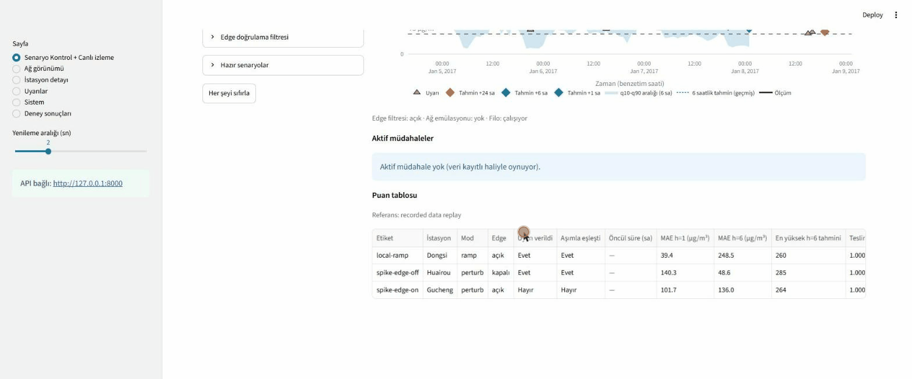
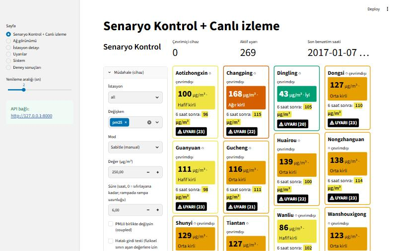
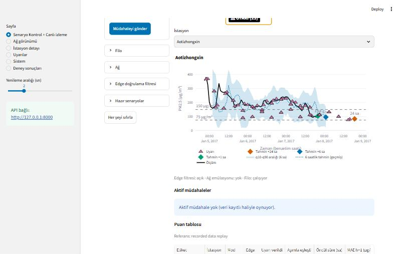
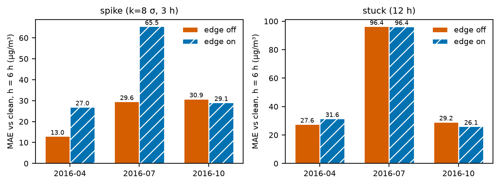

# airq-iot

[](https://github.com/furkantopcuu/airq-iot/actions/workflows/ci.yml)

IoT tabanlı hava kalitesi izleme, çok ufuklu PM2.5 tahmini ve erken uyarı. Pekin çok istasyonlu
hava kalitesi verisi, 12 sanal IoT cihazıyla MQTT üzerinden yeniden oynatılır (trace-driven
emülasyon), edge gateway'de doğrulanır, SQLite'a yazılır, LightGBM ile 1 / 6 / 24 saat sonrası
tahmin edilir ve canlı bir panoda gösterilir. Komut kanalı (MQTT `cmd` / `ack`) sistem çalışırken
sensör değerini değiştirmeyi, sensör arızası enjekte etmeyi, ağı bozmayı ve edge filtresini
açıp kapatmayı sağlar; puan tablosu tahminlerin ve uyarıların buna tepkisini ölçer.
English: [README.md](README.md).

Daha fazlası: [ARCHITECTURE.md](ARCHITECTURE.md) (parçalar nasıl birleşiyor, İngilizce),
[FINDINGS.md](FINDINGS.md) (deneylerin bulguları, işe yaramayanlar dahil, İngilizce),
[SECURITY.md](SECURITY.md), [CHANGELOG.md](CHANGELOG.md).


## Neler var

| Katman | İçerik | Yer |
|---|---|---|
| Cihazlar | 12 sanal sensör (her biri ayrı MQTT istemcisi, LWT, heartbeat, `seq`), ağ emülasyonu (kayıp, gecikme, jitter, sırasızlık) | `src/airq/devices/` |
| Edge | doğrulama, veri kalitesi bayrakları (aralık, ani değişim, takılma, PM2.5 <= PM10, eksik, `seq` boşluğu), isteğe bağlı filtre | `src/airq/edge/` |
| Sunucu | ingest (tek SQLite yazıcısı), predictor (çevrimdışıyla aynı `build_features`), FastAPI okuma + kontrol uçları | `src/airq/server/` |
| Kontrol | `cmd` / `ack` kanalı, cihaz modları (manual, offset, scale, ramp, spike / stuck / dropout, offline), filo ve edge kontrolü, 7 hazır senaryo | `src/airq/scenarios/`, `configs/scenarios/` |
| ML | sızıntısız özellikler, persistence / mevsimsel naif / ridge / LightGBM, Optuna, LOSO, SHAP, DM testleri | `src/airq/features/`, `src/airq/models/`, `src/airq/pipelines/` |
| Arayüz | Streamlit panosu (6 sayfa, senaryo kontrol paneli) | `src/airq/dashboard/` |

## Canlı pano

*Senaryo Kontrol + Canlı izleme* sayfasından, kaydedilmiş bir koşunun ekran görüntüleri (gerçek bir haze
epizodu, yerel kirlilik rampası ve sensör sıçraması arızaları, edge filtresi kapalı ve açık). Veri ya da
model olmadan kendiniz oynatabilirsiniz: `python -m scripts.fetch_release --only demo`, ardından
`python -m scripts.demo --offline`.

Aynı kayıt üzerinde panonun kısa bir turu (canlı sayfa ve puan tablosu, q10-q90 bandıyla istasyon
detayı, uyarılar):








## Sonuçlar

Aşağıdaki tablolar `reports/tables/*.csv` dosyalarından `python -m scripts.make_tables --readme`
ile üretilir. Negatif bulgular ve sınırlamalar dahil her bulgu [docs/KARARLAR.md](docs/KARARLAR.md)
dosyasında, her teknoloji seçiminin gerekçesi [docs/NEDEN.md](docs/NEDEN.md) dosyasındadır.

**RQ1 - ayrılmış test yılında tahmin hatası (RMSE, µg/m³; persistence'a göre iyileşme %)**

<!-- TABLE:rq1_main -->
| Model | RMSE h=1 | RMSE h=6 | RMSE h=24 | Δ% vs B0 h=1 | Δ% vs B0 h=6 | Δ% vs B0 h=24 |
|---|---|---|---|---|---|---|
| B0 persistence | 19.65 | 54.88 | 88.12 | 0.0 | 0.0 | 0.0 |
| B1 seasonal naive | 88.14 | 88.16 | 88.12 | -348.6 | -60.6 | 0.0 |
| B2 ridge (k=0) | 18.54 | 50.05 | 73.66 | 5.6 | 8.8 | 16.4 |
| M1 LightGBM (k=0) | 17.85 | 48.88 | 73.53 | 9.1 | 10.9 | 16.6 |
| M2a LightGBM (k=3) | 16.99 | 47.89 | 73.35 | 13.5 | 12.7 | 16.8 |
| M2b LightGBM (k=11) | 17.08 | 46.60 | 73.29 | 13.1 | 15.1 | 16.8 |
<!-- /TABLE:rq1_main -->


**RQ3b - hatalı sensör girdisi: edge filtresi kapalı / açık iken RMSE artışı (son 24 saatinde arıza olan satırlar)**

<!-- TABLE:rq3b -->
| Method | h | RMSE clean | Damage, edge off | Damage, edge on | Recovered (%) |
|---|---|---|---|---|---|
| B0 persistence | 1 h | 20.42 | 45.74 | 7.27 | 84.1 |
| B0 persistence | 6 h | 56.97 | 24.70 | 1.75 | 92.9 |
| B0 persistence | 24 h | 90.19 | 13.94 | 0.52 | 96.2 |
| M1 LightGBM (k=0) | 1 h | 19.04 | 27.00 | 18.96 | 29.8 |
| M1 LightGBM (k=0) | 6 h | 51.03 | 8.83 | 8.12 | 8.1 |
| M1 LightGBM (k=0) | 24 h | 76.01 | 1.77 | 1.58 | 10.8 |
| M2b LightGBM (k=11) | 1 h | 18.09 | 22.36 | 14.65 | 34.5 |
| M2b LightGBM (k=11) | 6 h | 48.40 | 2.34 | 1.54 | 34.1 |
| M2b LightGBM (k=11) | 24 h | 75.96 | 0.57 | 0.56 | 2.2 |
<!-- /TABLE:rq3b -->

**RQ4 - tahmin belirsizliği: [q10, q90] aralığının kapsaması (hedef 0,80) ve pinball kaybı; kalibrasyon katsayısı yalnızca doğrulama verisinde öğrenildi**

<!-- TABLE:rq4_coverage -->
| h | Interval | c | Coverage | Coverage, extreme | Mean width | Pinball q10 | Pinball q50 | Pinball q90 |
|---|---|---|---|---|---|---|---|---|
| 1 h | raw | 1.00 | 0.761 | 0.741 | 24.6 | 2.12 | 4.35 | 2.30 |
| 1 h | calibrated | 1.10 | 0.798 | 0.774 | 27.0 | 2.12 | 4.35 | 2.29 |
| 6 h | raw | 1.00 | 0.756 | 0.578 | 77.3 | 5.90 | 13.13 | 6.97 |
| 6 h | calibrated | 1.10 | 0.797 | 0.621 | 85.0 | 5.88 | 13.13 | 6.93 |
| 24 h | raw | 1.00 | 0.758 | 0.279 | 136.7 | 7.14 | 24.76 | 13.06 |
| 24 h | calibrated | 1.05 | 0.809 | 0.321 | 143.6 | 7.18 | 24.76 | 12.94 |
<!-- /TABLE:rq4_coverage -->

**RQ4 - q90 tabanlı uyarı ve nokta tahmin tabanlı uyarı (θ = 150)**

<!-- TABLE:rq4_warning -->
| h | Method | δ | Precision | Recall | F2 | False alarm | Horizon-matched recall | Matched lead (h) |
|---|---|---|---|---|---|---|---|---|
| 1 h | B0 persistence | 15 | 0.817 | 0.963 | 0.930 | 0.094 | 0.72 | 0.0 |
| 1 h | M2b LightGBM (k=11) | 10 | 0.865 | 0.955 | 0.936 | 0.070 | 0.66 | 1.0 |
| 1 h | M3 q90 (calibrated) | 0 | 0.794 | 0.982 | 0.937 | 0.112 | 0.55 | 1.0 |
| 1 h | M3 q90 (raw) | 0 | 0.807 | 0.979 | 0.939 | 0.108 | 0.58 | 1.0 |
| 6 h | B0 persistence | 40 | 0.530 | 0.856 | 0.762 | 0.218 | 0.83 | 3.0 |
| 6 h | M2b LightGBM (k=11) | 40 | 0.568 | 0.876 | 0.790 | 0.181 | 0.80 | 3.0 |
| 6 h | M3 q90 (calibrated) | 0 | 0.484 | 0.940 | 0.791 | 0.261 | 0.87 | 4.0 |
| 6 h | M3 q90 (raw) | 0 | 0.513 | 0.929 | 0.799 | 0.233 | 0.86 | 4.0 |
| 24 h | B0 persistence | 40 | 0.378 | 0.613 | 0.545 | 0.218 | 0.63 | 20.0 |
| 24 h | M2b LightGBM (k=11) | 40 | 0.482 | 0.528 | 0.518 | 0.173 | 0.52 | 21.0 |
| 24 h | M3 q90 (calibrated) | 0 | 0.296 | 0.862 | 0.623 | 0.404 | 0.79 | 21.0 |
| 24 h | M3 q90 (raw) | 0 | 0.309 | 0.853 | 0.631 | 0.381 | 0.79 | 21.0 |
<!-- /TABLE:rq4_warning -->


**Senaryo Kontrol - çalıştırmadan önce yazılan hipotezler ve canlı sistemin gerçek tepkisi** (senaryo başına tek koşu)

<!-- TABLE:scenarios -->
| Scenario | Item | Metric | Expected | Reference | Measured | Verdict |
|---|---|---|---|---|---|---|
| ag_bozulmasi | net-degraded | delivery_ratio | less than | 0.95 | 0.88 | confirmed |
| ag_bozulmasi | net-degraded | latency_p95_ms | greater than | 250.00 | 318.00 | confirmed |
| bolgesel_artis | regional-ramp | warned | true |  | True | confirmed |
| cihaz_kopmasi | three-offline | min_n_neighbors | less than | 11.00 | 8.00 | confirmed |
| gercek_haze_replay | haze-replay | warned | true |  | True | confirmed |
| gercek_haze_replay | haze-replay | lead_time_h | greater than | 0.00 | 22.00 | confirmed |
| sensor_sicramasi | spike-edge-off | peak_forecast_h6 | greater than | 54.00 | 87.69 | confirmed |
| sensor_sicramasi | spike-edge-off | warned | true |  | True | confirmed |
| sensor_takilmasi | stuck-edge-off | mae_next_6h_h6 | greater than | 12.57 | 10.54 | refuted |
| yerel_artis | local-ramp | warned | true |  | True | confirmed |
| yerel_artis | neighbor-huairou | peak_forecast_h6 | less than | 101.91 | 39.03 | confirmed |
<!-- /TABLE:scenarios -->


**Eşleştirilmiş koşular: aynı arıza penceresi, edge filtresi kapalı ve açık (3 başlangıç tarihi)**

<!-- TABLE:scenarios_ab -->
| Fault | Start | MAE h=1 off | MAE h=1 on | Δ h=1 | MAE h=6 off | MAE h=6 on | Δ h=6 |
|---|---|---|---|---|---|---|---|
| spike, 3 h | 2016-04-15 | 127.3 | 24.5 | 102.8 | 13.0 | 27.0 | -14.0 |
| spike, 3 h | 2016-07-20 | 79.7 | 36.8 | 42.9 | 29.6 | 65.5 | -35.9 |
| spike, 3 h | 2016-10-05 | 76.1 | 86.1 | -10.0 | 30.9 | 29.1 | 1.7 |
| spike, 3 h | mean of 3 | 94.4 | 49.1 | 45.2 | 24.5 | 40.6 | -16.1 |
| stuck, 12 h | 2016-04-15 | 29.3 | 32.6 | -3.2 | 27.6 | 31.6 | -4.0 |
| stuck, 12 h | 2016-07-20 | 46.3 | 51.4 | -5.2 | 96.4 | 96.4 | 0.1 |
| stuck, 12 h | 2016-10-05 | 43.5 | 49.4 | -5.8 | 29.2 | 26.1 | 3.1 |
| stuck, 12 h | mean of 3 | 39.7 | 44.4 | -4.7 | 51.1 | 51.4 | -0.3 |
<!-- /TABLE:scenarios_ab -->



Canlı sistem ölçümü (RQ3a: kayıp, gecikme, çevrimdışı cihaz, CPU ve bellek)
`reports/tables/rq3a_bench.csv` ve `reports/figures/rq3a_system.png` dosyalarındadır.

## Hızlı başlangıç (Linux, macOS, WSL, Git Bash)

```bash
bash scripts/quickstart.sh          # kurulum, kayıtlı koşuyu indirme, panoyu açma (veri ya da model gerekmez)
bash scripts/quickstart.sh test     # kurulum ve hızlı testler
bash scripts/quickstart.sh --help   # tüm kipler; --dry-run komutları çalıştırmadan gösterir
```

## Hızlı başlangıç (Windows PowerShell)

```powershell
py -3.11 -m venv .venv
.\.venv\Scripts\Activate.ps1
python -m pip install --upgrade pip
pip install -r requirements.txt      # sonuçların üretildiği tam sürümler için  -c constraints.txt  ekleyin
pip install -e .
pre-commit install
pytest -m "not broker and not slow"
```

MQTT broker: Mosquitto kurun (`winget install EclipseFoundation.Mosquitto`); kurulu değilse
`python -m airq.iot.broker` saf Python yedeğini (amqtt) başlatır, demo bunu sizin yerinize yapar.

## Canlı demo (tek komut)

Demo temizlenmiş veriye ve eğitilmiş modellere ihtiyaç duyar. Modeller depoda tutulmaz (release
asset): sağlama toplamı doğrulamalı olarak
`python -m scripts.fetch_release --only models` ile indirin ya da bir kez
`python -m scripts.run_all` ile üretin (aşağıya bakın).

```powershell
python -m scripts.demo
```

Broker kontrolü yapar (gerekirse başlatır); edge, ingest, predictor, cihaz filosu, API ve panoyu ayrı
süreçler olarak başlatır, 240 saatlik predictor ısınmasını hızla geçer, sonra gerçek bir haze
epizodu içinde saniyede 1 simüle saat oynatır ve panoyu açar. `Ctrl+C` hepsini kapatır.

1. **Planlı akış** - *Senaryo Kontrol + Canlı izleme* sayfasında "Hazır senaryolar" bölümünden sırayla
   `gercek_haze_replay`, `sensor_takilmasi`, `cihaz_kopmasi`, `ag_bozulmasi` çalıştırın.
2. **Serbest test** - "Müdahale (cihaz)" bölümünden istasyon ve değer seçin (örn. *Dongsi PM2.5'i 6
   saatte 300'e çıkar*). Fiziksel sınır dışı değerler, hatalı girdi kutusu işaretlenmedikçe
   reddedilir; "Her şeyi sıfırla" her zaman temiz duruma döner.
3. Ani sıçrama edge filtresi tarafından işaretlenip boşaltılır (`rate_jump`): edge görevini yapıyor.
   Gerçekçi bir kirlilik artışı için `ramp` kullanın ya da hasarı görmek için filtreyi kapatın.

**Veri ve model gerekmez:** `python -m scripts.fetch_release --only demo` kayıtlı bir koşuyu (müdahaleli
bir haze epizodu ve q10-q90 bandı) indirir, `python -m scripts.demo --offline` panoyu broker olmadan
bunun üzerinde açar (kontroller kapalı). `python -m scripts.demo --smoke` 10 saniyelik uçtan uca
kendi kendine testtir.

Windows'ta en kolay başlatma `.\fullbaslat.cmd`: ortamı kurar, açık demoyu kapatır, eksik veri ve modelleri indirir ve demoyu baştan açar (`-Realistic`, `-NoBrowser`).

Windows'ta `.\demo.ps1` aynısını projenin kendi sanal ortamıyla yapar (etkinleştirmek gerekmez; `-Realistic`, `-Offline`, `-StopOld`). Panoda Senaryo Kontrol > Filo, demo açıkken hızlı (3600×) ve gerçekçi (60×) hız arasında geçiş yapar.

Oynatma verinin sonuna kadar sürer (hızlı modda yaklaşık 27 dakika) ve bitince kendiliğinden baştan başlar, Ctrl+C'ye kadar; `--no-loop` sonda durdurur.

Hız: varsayılan akış saniyede bir simüle saat oynatır (3600x, değerler hızlı değişir). `python -m scripts.demo --realistic` her istasyonda dakikada bir yeni ölçüme yavaşlatır (60x), `--speedup N` istediğin hızı verir, panoda Filo > Hız ile canlı değiştirilir.

Canlı demo çökerse yedekler: `python -m scripts.demo --offline`, yukarıdaki tur (`docs/assets/demo_dashboard.gif`), panonun altı ekran görüntüsü (`slides/demo_screens/`) ve 24 saniyelik sessiz bir video (`slides/demo_backup.mp4`, `python -m scripts.make_demo_video` ile yeniden üretilir).

## Sonuçları yeniden üretme

```powershell
python -m scripts.run_all --home ..\airq-repro --quick   # dakikalar: 2 istasyon, Optuna yok (hat duman testi)
python -m scripts.run_all --home ..\airq-repro           # tam: saatler (çalışma başına 20 Optuna denemesi)
python -m scripts.run_all --home ..\airq-repro --with-system   # + RQ3a ölçümü ve senaryolar (broker gerekir)
python -m scripts.run_all --check                        # tüm çıktıların varlığını doğrular
```

`--home`, yeniden üretimi depodaki sonuçlardan ayrı tutar (`--quick` onsuz reddedilir). Aşamalar
çıktılarına göre önbelleklidir; yarım kalan çalışma kaldığı yerden sürer. Test seti her home için bir
kez değerlendirilir (koruma dosyaları); temiz bir home `--force` gerektirmez.

### Notebook'lar

Aynı hatların ince sarmalayıcıları (`notebooks/`, `scripts/build_notebooks.py` üretir); yerel Jupyter için tasarlandı. Her biri `QUICK = True` ile başlar (2 istasyon, birkaç dakika); tam çalışma için `QUICK = False` yapın. Proje Google Colab desteği iddia etmez: notebook'lar orada doğrulanmadı.

| Notebook | İçerik |
|---|---|
| `00_setup` | kurulum, indirme + SHA-256 kontrolü, temiz veri seti |
| `01_data_eda` | veri tablosu, korelasyon / eksik veri şekli, epizotlar |
| `02_forecast_rq1` | RQ1: baseline'lar, LightGBM, ablasyon, LOSO, SHAP |
| `03_early_warning_rq2` | RQ2: uyarı kuralı, haze epizotları, öncül süre |
| `04_robustness_rq3b` | RQ3b: hatalı girdi, edge filtresi açık / kapalı |
| `06_figures_tables` | tüm makale şekilleri ve tabloları |

## Makale

Makale (IEEEtran, Türkçe metin ve İngilizce özet) `paper/` altındadır: `main.tex`, `refs.bib`, `numbers.tex`,
`tables/` ve `figures/`. Klasörü Overleaf'e yükleyip `main.tex`'i derleyin (IEEEtran Overleaf'te hazırdır).
Metindeki her sayı `reports/`'tan üretilen bir makrodur (`python -m scripts.make_paper_numbers`;
[paper/NUMBERS.md](paper/NUMBERS.md) her makronun dosyasını, satır seçicisini ve sütununu verir).
`python -m scripts.check_paper` LaTeX kurulu olmadan kaynağı denetler. Kaynakça Crossref, DataCite ve
arXiv ile doğrulandı ([docs/makale_kaynak.md](docs/makale_kaynak.md)).
`paper/main.pdf` derlenmiş taslaktır (Overleaf; 8 sayfa, 6–8 sayfa hedefi içinde).

## Testler

```powershell
pytest -m "not broker and not slow"      # hızlı: birim testleri
pytest                                   # her şey, gerçek broker ile (Mosquitto ve amqtt)
```

CI birim testlerini Windows'ta (zorunlu) ve Ubuntu'da (Python 3.11 ve 3.12), notebook'ları fixture
kipinde, broker entegrasyon testlerini Ubuntu'da, pre-commit, mypy ve bağımlılık denetimini çalıştırır;
son koşu hepsinde geçiyor. `main`'e birleştirmek için Windows testleri ve kalite işi yeşil bir pull
request gerekir. `slow` işaretli testler yalnızca yerelde çalışır.

## Sınırlamalar

- Veri, düşük maliyetli sensörlerden değil referans istasyonlardan gelir; değerlendirme saha
  çalışması değil, trace-driven emülasyondur.
- Ağ bozulması uygulama katmanında emüle edilir (kaybolan mesaj hiç yayınlanmaz), işletim sistemi
  düzeyindeki `tc netem` ile değil (Windows). Bu yüzden MQTT yeniden iletimi devreye girmez ve TCP
  kuyruklanmasının kuyruk gecikmesine etkisi **ölçülmemiştir**.
- Tüm sistem ölçümleri tek makineden gelir (mutlak değerler makineye özgüdür). RQ3a, belirtilen
  grid'in tamamını 3 tekrarla koşmuştur; hazır senaryolar birer kez, eşleştirilmiş edge açık /
  kapalı karşılaştırması ise arıza türü başına 3 pencerede koşmuştur (anlamlılık testi yok).
- 3600×'te (saniyede 1 simüle saat) veri kaybında (eksik istasyon için 500 ms beklenir) tahmin
  servisi geride kalır; tablo kaç koşunun geride kaldığını verir. `offline` bildiren cihaz için
  artık beklenmez (kıyaslama buldu, düzeltildi, yeniden ölçüldü: 1 kopuk cihazda medyan uyarı
  gecikmesi 148,9 sn → 37,0 sn, geride kalan koşu yok); kaybolan mesaj ise bir şey bildirmediği
  için o bekleme sürer.
- Komut kanalında kimlik doğrulama yoktur (yalnızca localhost); gerçek dağıtımda MQTT ACL + TLS gerekir.
- Modeller aşırı kirlilik tepelerini olduğundan düşük tahmin eder (`reports/tables/rq1_extreme.csv`).

## Yapı

`src/airq/` kütüphane - `scripts/` komut satırı girişleri - `configs/` YAML yapılandırma ve
senaryolar - `notebooks/` ince notebook'lar (`scripts/build_notebooks.py` üretir) -
`reports/` sonuç tabloları, metrikler, şekiller, senaryo koşuları - `paper/tables/` üretilmiş LaTeX /
Markdown tablolar - `docs/` karar günlüğü ve bileşen gerekçeleri - `tests/`. Parçaların birleşimi:
[ARCHITECTURE.md](ARCHITECTURE.md); deney bulguları: [FINDINGS.md](FINDINGS.md).
`slides/` sunum malzemesini içerir: her teknik slayta bir "neden?" kutusu koyan slayt iskeleti, konuşmacı notları ve olası jüri soruları ile kısa cevaplar. `slides/src/`'den üretilir (`python -m scripts.make_slides`); slayttaki her sayı makaledeki sayıdır. `slides/airq_iot_sunum.pptx` bitmiş sunumdur (konuşmacı notlarıyla 23 slayt; `python -m scripts.make_pptx`), aynı sayılarla üretilir; `slides/hazirlik.md` sunum için çalışma rehberidir.

## Lisans

MIT. Veri seti: Beijing Multi-Site Air-Quality Data, UCI ML Repository, doi:10.24432/C5RK5G, CC BY 4.0.

## Yazarlar

Orhan Akbaba, Furkan Topçu - İstanbul Medeniyet Üniversitesi, Bilgisayar Mühendisliği (IoT dersi dönem projesi).
Atıf için [CITATION.cff](CITATION.cff).
