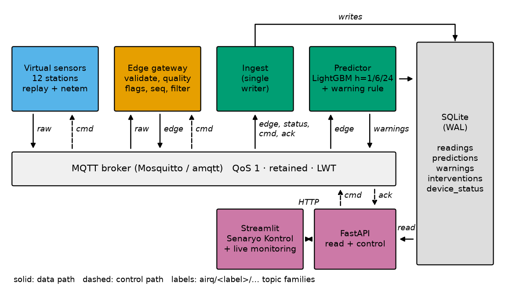
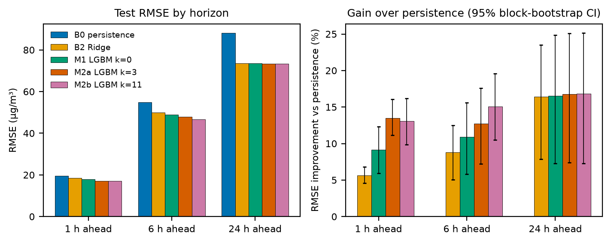
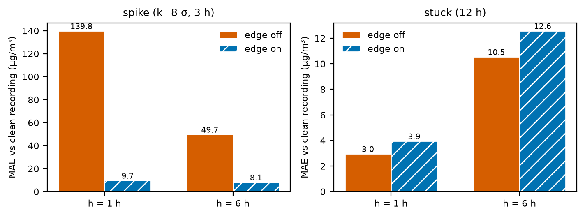

# airq-iot

[](https://github.com/furkantopcuu/airq-iot/actions/workflows/ci.yml)

IoT tabanlı hava kalitesi izleme, çok ufuklu PM2.5 tahmini ve erken uyarı. Pekin çok istasyonlu
hava kalitesi verisi, 12 sanal IoT cihazıyla MQTT üzerinden yeniden oynatılır (trace-driven
emülasyon), edge gateway'de doğrulanır, SQLite'a yazılır, LightGBM ile 1 / 6 / 24 saat sonrası
tahmin edilir ve canlı bir panoda gösterilir. Komut kanalı (MQTT `cmd` / `ack`) sistem çalışırken
sensör değerini değiştirmeyi, sensör arızası enjekte etmeyi, ağı bozmayı ve edge filtresini
açıp kapatmayı sağlar; puan tablosu tahminlerin ve uyarıların buna tepkisini ölçer.
English: [README.md](README.md).



## Neler var

| Katman | İçerik | Yer |
|---|---|---|
| Cihazlar | 12 sanal sensör (her biri ayrı MQTT istemcisi, LWT, heartbeat, `seq`), ağ emülasyonu (kayıp, gecikme, jitter, sırasızlık) | `src/airq/devices/` |
| Edge | doğrulama, veri kalitesi bayrakları (aralık, ani değişim, takılma, PM2.5 <= PM10, eksik, `seq` boşluğu), isteğe bağlı filtre | `src/airq/edge/` |
| Sunucu | ingest (tek SQLite yazıcısı), predictor (çevrimdışıyla aynı `build_features`), FastAPI okuma + kontrol uçları | `src/airq/server/` |
| Kontrol | `cmd` / `ack` kanalı, cihaz modları (manual, offset, scale, ramp, spike / stuck / dropout, offline), filo ve edge kontrolü, 7 hazır senaryo | `src/airq/scenarios/`, `configs/scenarios/` |
| ML | sızıntısız özellikler, persistence / mevsimsel naif / ridge / LightGBM, Optuna, LOSO, SHAP, DM testleri | `src/airq/features/`, `src/airq/models/`, `src/airq/pipelines/` |
| Arayüz | Streamlit panosu (6 sayfa, senaryo kontrol paneli) | `src/airq/dashboard/` |

## Sonuçlar

Aşağıdaki tablolar `reports/tables/*.csv` dosyalarından `python -m scripts.make_tables --readme`
ile üretilir. Negatif bulgular ve sınırlamalar dahil her bulgu [docs/KARARLAR.md](docs/KARARLAR.md)
dosyasında, her teknoloji seçiminin gerekçesi [docs/NEDEN.md](docs/NEDEN.md) dosyasındadır.

**RQ1 - ayrılmış test yılında tahmin hatası (RMSE, µg/m³; persistence'a göre iyileşme %)**

<!-- TABLE:rq1_main -->
| Model | RMSE h=1 | RMSE h=6 | RMSE h=24 | Δ% vs B0 h=1 | Δ% vs B0 h=6 | Δ% vs B0 h=24 |
|---|---|---|---|---|---|---|
| B0 persistence | 19.65 | 54.88 | 88.12 | 0.0 | 0.0 | 0.0 |
| B1 seasonal naive | 88.14 | 88.16 | 88.12 | -348.6 | -60.6 | 0.0 |
| B2 ridge (k=0) | 18.54 | 50.05 | 73.66 | 5.6 | 8.8 | 16.4 |
| M1 LightGBM (k=0) | 17.85 | 48.88 | 73.53 | 9.1 | 10.9 | 16.6 |
| M2a LightGBM (k=3) | 16.99 | 47.89 | 73.35 | 13.5 | 12.7 | 16.8 |
| M2b LightGBM (k=11) | 17.08 | 46.60 | 73.29 | 13.1 | 15.1 | 16.8 |
<!-- /TABLE:rq1_main -->



**RQ3b - hatalı sensör girdisi: edge filtresi kapalı / açık iken RMSE artışı (son 24 saatinde arıza olan satırlar)**

<!-- TABLE:rq3b -->
| Method | h | RMSE clean | Damage, edge off | Damage, edge on | Recovered (%) |
|---|---|---|---|---|---|
| B0 persistence | 1 h | 20.42 | 45.74 | 7.27 | 84.1 |
| B0 persistence | 6 h | 56.97 | 24.70 | 1.75 | 92.9 |
| B0 persistence | 24 h | 90.19 | 13.94 | 0.52 | 96.2 |
| M1 LightGBM (k=0) | 1 h | 19.04 | 27.00 | 18.96 | 29.8 |
| M1 LightGBM (k=0) | 6 h | 51.03 | 8.83 | 8.12 | 8.1 |
| M1 LightGBM (k=0) | 24 h | 76.01 | 1.77 | 1.58 | 10.8 |
| M2b LightGBM (k=11) | 1 h | 18.09 | 22.36 | 14.65 | 34.5 |
| M2b LightGBM (k=11) | 6 h | 48.40 | 2.34 | 1.54 | 34.1 |
| M2b LightGBM (k=11) | 24 h | 75.96 | 0.57 | 0.56 | 2.2 |
<!-- /TABLE:rq3b -->

**Senaryo Kontrol - çalıştırmadan önce yazılan hipotezler ve canlı sistemin gerçek tepkisi** (senaryo başına tek koşu)

<!-- TABLE:scenarios -->
| Scenario | Item | Metric | Expected | Reference | Measured | Verdict |
|---|---|---|---|---|---|---|
| ag_bozulmasi | net-degraded | delivery_ratio | less than | 0.95 | 0.88 | confirmed |
| ag_bozulmasi | net-degraded | latency_p95_ms | greater than | 250.00 | 318.00 | confirmed |
| bolgesel_artis | regional-ramp | warned | true |  | True | confirmed |
| cihaz_kopmasi | three-offline | min_n_neighbors | less than | 11.00 | 8.00 | confirmed |
| gercek_haze_replay | haze-replay | warned | true |  | True | confirmed |
| gercek_haze_replay | haze-replay | lead_time_h | greater than | 0.00 | 22.00 | confirmed |
| sensor_sicramasi | spike-edge-off | peak_forecast_h6 | greater than | 54.00 | 87.69 | confirmed |
| sensor_sicramasi | spike-edge-off | warned | true |  | True | confirmed |
| sensor_takilmasi | stuck-edge-off | mae_next_6h_h6 | greater than | 12.57 | 10.54 | refuted |
| yerel_artis | local-ramp | warned | true |  | True | confirmed |
| yerel_artis | neighbor-huairou | peak_forecast_h6 | less than | 101.91 | 39.03 | confirmed |
<!-- /TABLE:scenarios -->



Canlı sistem ölçümü (RQ3a: kayıp, gecikme, çevrimdışı cihaz, CPU ve bellek)
`reports/tables/rq3a_bench.csv` ve `reports/figures/rq3a_system.png` dosyalarındadır.

## Hızlı başlangıç (Windows PowerShell)

```powershell
py -3.11 -m venv .venv
.\.venv\Scripts\Activate.ps1
python -m pip install --upgrade pip
pip install -r requirements.txt
pip install -e .
pre-commit install
pytest -m "not broker and not slow"
```

MQTT broker: Mosquitto kurun (`winget install EclipseFoundation.Mosquitto`); kurulu değilse
`python -m airq.iot.broker` saf Python yedeğini (amqtt) başlatır, demo bunu sizin yerinize yapar.

## Canlı demo (tek komut)

Demo temizlenmiş veriye ve eğitilmiş modellere ihtiyaç duyar. Modeller depoda tutulmaz (release
asset); bir kez `python -m scripts.run_all` ile üretin (aşağıya bakın) ya da bir Colab çalışmasının
`airq_artifacts_<tarih>.zip` dosyasını `python -m scripts.import_artifacts <zip>` ile yükleyin.

```powershell
python -m scripts.demo
```

Broker kontrolü yapar (gerekirse başlatır); edge, ingest, predictor, cihaz filosu, API ve panoyu ayrı
süreçler olarak başlatır, 240 saatlik predictor ısınmasını hızla geçer, sonra gerçek bir haze
epizodu içinde saniyede 1 simüle saat oynatır ve panoyu açar. `Ctrl+C` hepsini kapatır.

1. **Planlı akış** - *Senaryo Kontrol + Canlı izleme* sayfasında "Hazır senaryolar" bölümünden sırayla
   `gercek_haze_replay`, `sensor_takilmasi`, `cihaz_kopmasi`, `ag_bozulmasi` çalıştırın.
2. **Serbest test** - "Müdahale (cihaz)" bölümünden istasyon ve değer seçin (örn. *Dongsi PM2.5'i 6
   saatte 300'e çıkar*). Fiziksel sınır dışı değerler, hatalı girdi kutusu işaretlenmedikçe
   reddedilir; "Her şeyi sıfırla" her zaman temiz duruma döner.
3. Ani sıçrama edge filtresi tarafından işaretlenip boşaltılır (`rate_jump`): edge görevini yapıyor.
   Gerçekçi bir kirlilik artışı için `ramp` kullanın ya da hasarı görmek için filtreyi kapatın.

`python -m scripts.demo --offline` panoyu broker olmadan kayıtlı bir SQLite dosyasıyla açar (kontroller
kapalı); `python -m scripts.demo --smoke` 10 saniyelik uçtan uca kendi kendine testtir.

## Sonuçları yeniden üretme

```powershell
python -m scripts.run_all --home ..\airq-repro --quick   # dakikalar: 2 istasyon, Optuna yok (hat duman testi)
python -m scripts.run_all --home ..\airq-repro           # tam: saatler (çalışma başına 20 Optuna denemesi)
python -m scripts.run_all --home ..\airq-repro --with-system   # + RQ3a ölçümü ve senaryolar (broker gerekir)
python -m scripts.run_all --check                        # tüm çıktıların varlığını doğrular
```

`--home`, yeniden üretimi depodaki sonuçlardan ayrı tutar (`--quick` onsuz reddedilir). Aşamalar
çıktılarına göre önbelleklidir; yarım kalan çalışma kaldığı yerden sürer. Test seti her home için bir
kez değerlendirilir (koruma dosyaları); temiz bir home `--force` gerektirmez.

### Colab notebook'ları

ML kısmı tarayıcıda yeniden üretilir; canlı IoT sistemi (broker, filo, edge, pano, demo, RQ3a,
senaryolar) Colab'da kalıcı servis ve güvenilir gecikme olmadığı için yalnızca yerelde çalışır.

| Notebook | İçerik |
|---|---|
| [](https://colab.research.google.com/github/furkantopcuu/airq-iot/blob/main/notebooks/00_setup_colab.ipynb) `00_setup_colab` | kurulum, indirme + SHA-256 kontrolü, temiz veri seti |
| [](https://colab.research.google.com/github/furkantopcuu/airq-iot/blob/main/notebooks/01_data_eda.ipynb) `01_data_eda` | veri tablosu, korelasyon / eksik veri şekli, epizotlar |
| [](https://colab.research.google.com/github/furkantopcuu/airq-iot/blob/main/notebooks/02_forecast_rq1.ipynb) `02_forecast_rq1` | RQ1: baseline'lar, LightGBM, ablasyon, LOSO, SHAP |
| [](https://colab.research.google.com/github/furkantopcuu/airq-iot/blob/main/notebooks/03_early_warning_rq2.ipynb) `03_early_warning_rq2` | RQ2: uyarı kuralı, haze epizotları, öncül süre |
| [](https://colab.research.google.com/github/furkantopcuu/airq-iot/blob/main/notebooks/04_robustness_rq3b.ipynb) `04_robustness_rq3b` | RQ3b: hatalı girdi, edge filtresi açık / kapalı |
| [](https://colab.research.google.com/github/furkantopcuu/airq-iot/blob/main/notebooks/06_figures_tables.ipynb) `06_figures_tables` | tüm makale şekilleri ve tabloları |

Her notebook `QUICK = True` ile başlar (2 istasyon, birkaç dakika); tam çalışma için `QUICK = False`
yapın. Sonuçlar `airq_artifacts_<tarih>.zip` olarak dışa aktarılır ve yerelde
`python -m scripts.import_artifacts <zip>` ile içe aktarılır (model manifest'ini denetler).

## Testler

```powershell
pytest -m "not broker and not slow"      # hızlı: birim testleri
pytest                                   # her şey, gerçek broker ile (Mosquitto ve amqtt)
```

CI birim testlerini Windows'ta (zorunlu) ve Ubuntu'da, notebook'ları fixture kipinde çalıştırır.
Ubuntu'daki broker entegrasyon işi şu an başarısız ve zorunlu değil (`docs/KARARLAR.md`'de açık
madde); tam test takımı yalnızca Windows'ta doğrulanmıştır.

## Sınırlamalar

- Veri, düşük maliyetli sensörlerden değil referans istasyonlardan gelir; değerlendirme saha
  çalışması değil, trace-driven emülasyondur.
- Ağ bozulması uygulama katmanında emüle edilir (kaybolan mesaj hiç yayınlanmaz), işletim sistemi
  düzeyindeki `tc netem` ile değil (Windows). Bu yüzden MQTT yeniden iletimi devreye girmez ve TCP
  kuyruklanmasının kuyruk gecikmesine etkisi **ölçülmemiştir**.
- Tüm sistem ölçümleri tek makineden gelir (mutlak değerler makineye özgüdür); RQ3a planı süre
  bütçesine sığsın diye kısaltılmıştır ve her senaryo bir kez çalıştırılmıştır (varyans yok).
- Komut kanalında kimlik doğrulama yoktur (yalnızca localhost); gerçek dağıtımda MQTT ACL + TLS gerekir.
- Modeller aşırı kirlilik tepelerini olduğundan düşük tahmin eder (`reports/tables/rq1_extreme.csv`).

## Yapı

`src/airq/` kütüphane - `scripts/` komut satırı girişleri - `configs/` YAML yapılandırma ve
senaryolar - `notebooks/` ince Colab notebook'ları (`scripts/build_notebooks.py` üretir) -
`reports/` sonuç tabloları, metrikler, şekiller, senaryo koşuları - `paper/tables/` üretilmiş LaTeX /
Markdown tablolar - `docs/` karar günlüğü ve bileşen gerekçeleri - `tests/`.

## Lisans

MIT. Veri seti: Beijing Multi-Site Air-Quality Data, UCI ML Repository, doi:10.24432/C5RK5G, CC BY 4.0.

## Yazarlar

Orhan Akbaba, Furkan Topçu - İstanbul Medeniyet Üniversitesi, Bilgisayar Mühendisliği (IoT dersi dönem projesi).
Atıf için [CITATION.cff](CITATION.cff).
